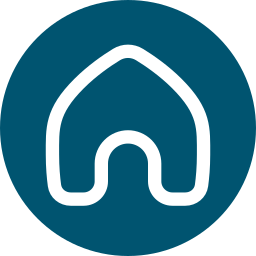
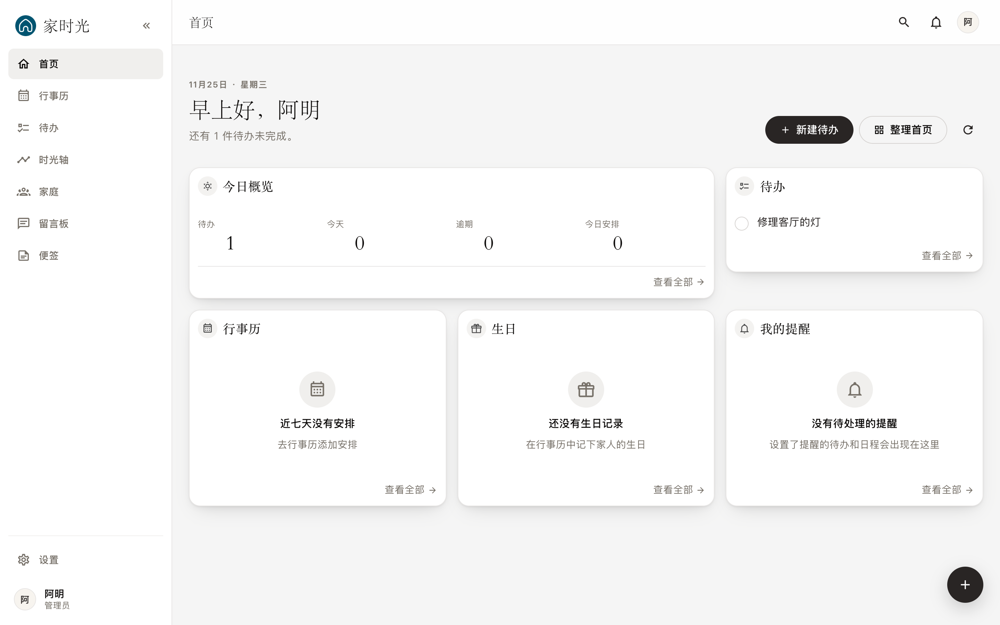
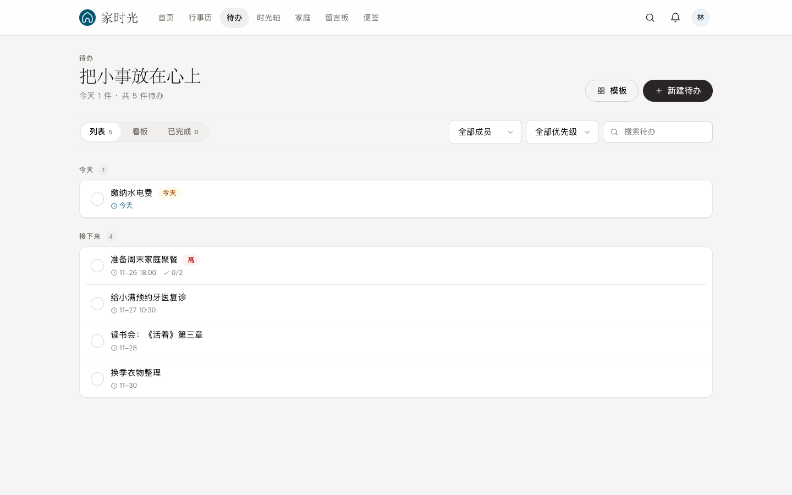
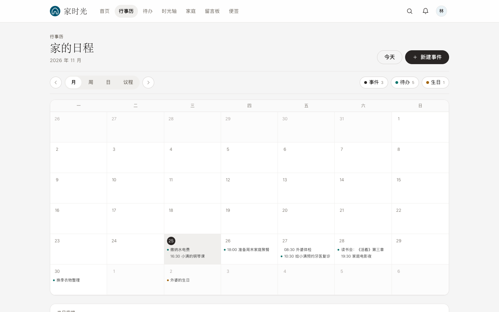
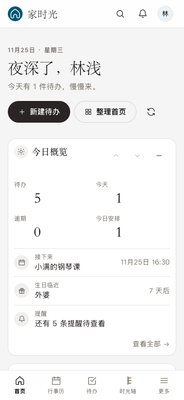

<p align="center">
  
</p>

<h1 align="center">家时光 · MyMoments</h1>

<p align="center">把一家人的日子，安静地放在一起。</p>

家时光是一个可自托管的家庭生活面板：待办、行事历、生日、留言、便签、提醒、天气与家庭通讯录集中在同一个首页，数据保存在自己的服务器上。界面为中文、移动端优先，同时支持 PWA 安装到桌面与手机。



## 功能介绍

### 首页仪表盘

- 11 种卡片：今日概览、待办、行事历、生日、提醒、时光轴、留言、便签、天气、家庭成员、通讯录。
- 每张卡片可调整顺序、尺寸（标准 / 宽 / 高）与背景色调，也可以折叠或隐藏。
- 支持保存为个人布局，管理员可将当前布局发布为家庭默认布局，新成员自动沿用。
- 概览卡片汇总当天安排、逾期待办、最近生日与未读提醒；单张卡片出错不影响其他卡片。
- 桌面端 12 栏网格，窄屏自动降为两栏与单栏，支持键盘操作与减少动效偏好。

### 待办

- 列表按已逾期、今天、接下来、未排期分组，另有看板视图；支持优先级、截止时间、子任务与备注。
- 可设置提前提醒、重复任务与常用模板，完成后保留在历史中可追溯。

### 行事历与生日

- 月、周、日、议程四种视图，事件支持地点、颜色与可见范围。
- 生日按公历月日循环计算，显示年龄与倒计时，临近生日会出现在首页卡片。
- 事件可设置提醒，提醒会进入通知中心。

### 时光轴与留言板

- 时光轴按时间回望家庭的事件、待办、生日、留言与便签，形成可翻阅的家庭记录。
- 留言板支持发表、回复与置顶，可为每条内容设置可见范围。

### 便签与家庭通讯录

- 便签支持正文、清单与心情色，可置顶；含发生日期的便签会自动进入时光轴。
- 通讯录按分类整理亲友、学校、医疗等联系方式，支持一键拨号与复制。

### 天气

- 由 Open-Meteo 提供数据，服务端代理并缓存，上游异常时回退到最近一次结果。
- 位置优先使用当前坐标，其次个人偏好，最后家庭默认城市。

### 家庭协作与权限

- 管理员可创建家庭成员账号并生成临时密码，成员首次登录需修改密码。
- 内容可设置为仅自己、指定成员或全家可见；管理员可管理成员状态与重置密码。

### AI 与 API

- 设置页可创建 API Token，按模块授予读取、写入、删除权限，可随时撤销。
- Token 只能访问业务数据，不能管理账号或 Token 本身，所有调用写入审计表。
- 提供服务端内置的 `/skill.md` 与 `/openapi.yaml`，方便把家庭数据接入 ChatGPT、Claude 等 AI Agent。

<table>
  <tr>
    <td width="33%"></td>
    <td width="33%"></td>
    <td width="33%"></td>
  </tr>
  <tr>
    <td align="center">待办</td>
    <td align="center">行事历</td>
    <td align="center">移动端</td>
  </tr>
</table>

## 安装说明

### 方式一：Docker Compose（推荐）

需要 Docker 与 Docker Compose。仓库自带最简 `docker-compose.yml`：

```yaml
services:
  mymoments:
    image: poxenstudio/mymoments:latest
    build: .
    restart: unless-stopped
    ports:
      - "8080:8080"
    volumes:
      - ./data:/data
```

```bash
git clone <repository-url> mymoments
cd mymoments
docker compose up -d --build
```

打开 <http://localhost:8080>，按首次引导创建家庭与管理员账号即可。系统没有预置的默认账号或密码，首次访问时创建管理员所填写的密码即为登录密码。

数据写入容器内的 `/data` 目录，Compose 通过命名卷 `mymoments-data` 持久化（实际存放位置由 Docker 管理），升级时重新执行 `docker compose up -d --build` 不会丢失。如需改为宿主机目录，把 `docker-compose.yml` 中的 `mymoments-data:/data` 改为 `./data:/data`，并确保该目录对容器内的 `app` 用户可写。

所有环境变量在镜像里已内置默认值，无需额外配置；需要覆盖时在 compose 的 `environment` 中追加对应变量即可（完整清单见下表与 `.env.example`）：

```yaml
services:
  mymoments:
    # ...
    environment:
      MYMOMENTS_DEFAULT_TZ: Asia/Tokyo
      MYMOMENTS_SESSION_SECRET: 请换成足够长的随机字符串
```

| 变量 | 默认值 | 说明 |
| --- | --- | --- |
| `MYMOMENTS_DEFAULT_TZ` | `Asia/Shanghai` | 家庭默认时区 |
| `MYMOMENTS_SESSION_SECRET` | 自动生成 | 会话签名密钥，留空时写入数据目录并复用 |
| `MYMOMENTS_WEATHER_PROVIDER` | `open-meteo` | 天气数据源 |
| `MYMOMENTS_WEATHER_API_KEY` | 空 | 天气服务密钥（Open-Meteo 无需填写） |
| `MYMOMENTS_HOUSEHOLD_QUOTA` | `1073741824` | 家庭附件总配额（字节） |
| `MYMOMENTS_TRUST_PROXY` | `false` | 位于反向代理后时设为 `true` |
| `MYMOMENTS_TLS_CERT` | 空 | 内置 HTTPS 的证书路径（容器内），与 `MYMOMENTS_TLS_KEY` 同时设置才生效 |
| `MYMOMENTS_TLS_KEY` | 空 | 内置 HTTPS 的私钥路径（容器内） |

### 启用 HTTPS

两种方式二选一：让应用自己提供 HTTPS，或交给反向代理终止 TLS。

#### 方式一：内置 HTTPS（无需反向代理）

准备证书文件（Let's Encrypt 签发或自签均可），把证书目录挂进容器，并同时设置证书与私钥路径：

```yaml
services:
  mymoments:
    image: mymoments:latest
    restart: unless-stopped
    ports:
      - "443:8080"                  # 容器内仍监听 8080，宿主机对外暴露 443
    volumes:
      - ./certs:/certs:ro           # certs/ 下放置 fullchain.pem 与 privkey.pem
    environment:
      MYMOMENTS_TLS_CERT: /certs/fullchain.pem
      MYMOMENTS_TLS_KEY: /certs/privkey.pem
```

启动后访问 `https://<host>/`。启用后会话 Cookie 的 `Secure` 与 HSTS 响应头会自动生效，容器健康检查也会自动改用 HTTPS 探测。

注意事项：

- 两个变量必须同时设置，只设置其中一个会启动失败。
- 证书文件需对容器内 `app` 用户可读；私钥常见权限是 `0600`，挂载后按需 `chmod 644` 或调整属主。
- 自签证书需要让浏览器与客户端信任对应 CA，否则 PWA 安装、定位等依赖安全上下文的能力不可用。
- 应用只在该端口提供 HTTPS，不做 HTTP → HTTPS 跳转；需要 80 跳 443 时仍要在前面放一层反向代理。

#### 方式二：反向代理终止 TLS

保持应用只监听内网 HTTP（如 `127.0.0.1:8080`），由 Caddy / Nginx / Traefik 负责证书与 443：

```nginx
location / {
  proxy_pass http://127.0.0.1:8080;
  proxy_set_header Host $host;
  proxy_set_header X-Forwarded-Proto $scheme;
  proxy_set_header X-Forwarded-For $proxy_add_x_forwarded_for;
}
```

反代部署时把 `MYMOMENTS_TRUST_PROXY` 设为 `true`，以便记录真实客户端 IP。

### 方式二：从源码运行

需要 Go 1.23+、Node.js 20+ 与 npm。

```bash
make web-build        # 安装前端依赖、构建并嵌入静态资源
go run ./cmd/server   # 默认监听 :8080，数据写入 ./data
```

也可以构建单文件二进制：

```bash
make build
./build/mymoments
```

本地开发时前后端分开启动，Vite 会把 `/api` 代理到 `127.0.0.1:8080`：

```bash
make api   # 终端一：后端
make web   # 终端二：前端 http://127.0.0.1:5173
```

运行检查：

```bash
make check   # gofmt、go vet、Go 测试与前端测试、lint
```

### 首次使用

1. 打开站点，填写家庭名称并创建管理员账号（系统无默认密码，登录密码即此处设置的密码）。
2. 在「家庭」页添加成员，设置临时密码并告知对方。
3. 在「设置 → 家庭设置」选择时区与家庭默认城市，天气卡片即可自动获取。
4. 在首页「整理首页」中调整卡片，管理员可发布为家庭默认布局。

> 建议通过 HTTPS（内置 TLS 或反向代理）对外提供服务，并定期备份 `mymoments-data` 卷（或你绑定的宿主机目录）中的 `db/moments.db`、`media/` 与 `logs/`。
